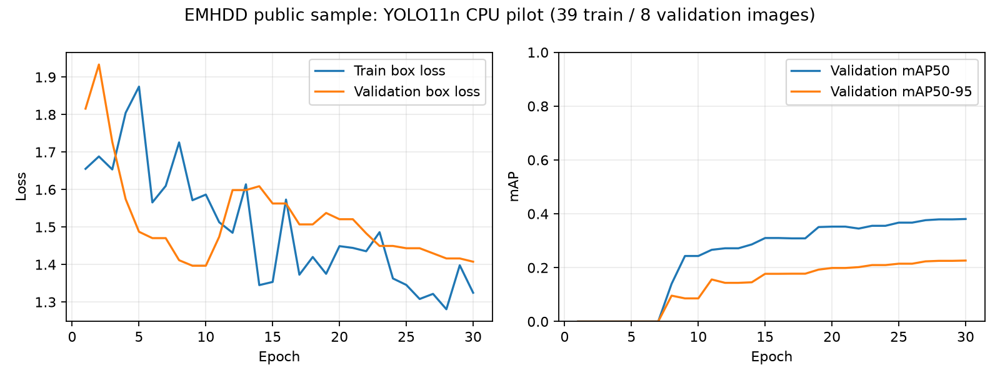

# Model card: YOLO11n EMHDD public-sample pilot

**Trạng thái:** đã train và kiểm thử pipeline; **chưa phù hợp triển khai**.
Mục tiêu nghiên cứu là giao thông xe máy; model hiện chỉ nhận diện vùng đầu
`no_helmet`/`helmet`, chưa xác nhận loại xe hoặc liên kết đầu với người đi xe.
Nguồn có cả xe đạp/xe điện và người đứng gần xe; chưa đủ chứng minh độ chính xác
trên giao thông xe máy Việt Nam.

## Training đã chạy

| Thuộc tính | Giá trị |
|---|---|
| Model | YOLO11n pretrained COCO; freeze 10 module đầu |
| Framework | PyTorch 2.6.0+cpu; Ultralytics 8.3.220; Python 3.12.14 |
| Tài nguyên | CPU, 4 thread; không có CUDA GPU |
| Input / batch | 640 px / 4 |
| Optimizer | AdamW, lr0=0.001, weight decay=0.0005 |
| Seed | 42 |
| Epoch hoàn tất | 30/30; early stopping không kích hoạt |
| Training + validation | 277,2 giây (~4,6 phút); không gồm tải/cài đặt |
| Best checkpoint | Epoch 30; chọn theo validation mAP50–95 |
| Validation best | mAP50=38,1%; mAP50–95=22,6% |
| Dataset | 56 ảnh ban ngày; train/val/test = 39/8/9 |

Đầu vào pretrained được tải từ release chính thức, SHA256 pin trong
`scripts/bootstrap_weights.py`. Audit dữ liệu, IDs và split ở
[dataset-audit.json](dataset-audit.json). Checkpoint:
`/workspace/Research-Helmet-Detection/artifacts/best.pt`.

## Test giữ riêng: 9 ảnh, 22 vùng đầu

| Lớp | Ground truth | AP50 | AP50–95 |
|---|---:|---:|---:|
| no_helmet | 18 | 50,1% | 23,8% |
| helmet | 4 | 35,8% | 25,0% |
| Trung bình hai lớp | 22 | **43,0%** | **24,4%** |

mAP lấy từ evaluator của Ultralytics ở nhiều confidence/IoU; không đồng nghĩa
với tỉ lệ cảnh báo đúng ở threshold sử dụng trong sản phẩm.

**Operating point cố định:** confidence ≥0,25, greedy matching theo confidence,
IoU ≥0,5, cùng class, một prediction chỉ khớp một ground truth.

| Lớp | TP | FP | FN | Precision | Recall | F1 |
|---|---:|---:|---:|---:|---:|---:|
| no_helmet | 10 | 4 | 8 | **71,4%** | **55,6%** | 62,5% |
| helmet | 2 | 5 | 2 | 28,6% | 50,0% | 36,4% |

Có 5 ground-truth box có cạnh chuẩn hóa nhỏ nhất ×640 <8 px, cho thấy nhiều
đầu rất nhỏ ở resolution pilot. Chỉ có 4 mẫu helmet trong test: mỗi lỗi làm recall
thay đổi 25 điểm phần trăm. Không đủ dữ liệu để kết luận độ tin cậy trên camera mới.
Một số cảnh có thể liên quan giữa các tập do thiếu video/camera IDs.

Kết quả cho thấy model còn bỏ sót và cảnh báo sai đáng kể; chưa đạt các mục tiêu
nghiệm thu đề xuất trong research plan. Không sử dụng để tự động kết luận vi phạm.

## Inference và export đã kiểm thử

- Đã chạy inference trên cả 9 ảnh test, tạo 9 ảnh có box và 9 dòng JSON hợp lệ.
- Batch=1 trên CPU sau warm-up: median 132,8 ms, p95 365,3 ms,
  trung bình 171,7 ms (~5,8 ảnh/s). Bao gồm decode ảnh, preprocessing,
  inference và NMS; không gồm RTSP, tracking, render hay network.
  Mẫu chỉ 9 ảnh và máy cloud có thể có tải nền: đây là phép đo pilot, không phải SLA.
- Export ONNX opset 17, input cố định `[1,3,640,640]`, output `[1,6,8400]`.
  `onnx.checker` qua; ONNX Runtime CPU khớp PyTorch trước NMS với
  rtol=1e-3, atol=1e-3. Sai khác tuyệt đối lớn nhất trên tensor thử là 0,001312.
- Kiểm tra thêm một ảnh test thật với padding 640×640 giống nhau: PyTorch và ONNX
  cùng tạo 2 detection; sai khác box/score tối đa 0,000122.
- Graph chưa tích hợp NMS. Cần letterbox, RGB/CHW/float32/255,
  lọc confidence, NMS và đổi box về tọa độ ảnh gốc.
- Script setup đã chạy lại thành công; audit và split không đổi; `pip check` qua.
  Chưa kiểm chứng phục hồi trong task mới hoặc publish môi trường.

Chi tiết máy đọc được:
[metrics.json](../artifacts/metrics.json),
[operating-point.json](../artifacts/operating-point.json),
[export metadata](../artifacts/best.json),
[kiểm tra ONNX trên ảnh thật](../artifacts/onnx-real-image-validation.json).

## Giới hạn và quyền sử dụng

Model học từ phần EMHDD public chưa thấy license rõ ràng. Trước khi phân phối
weights/data hoặc triển khai cần xác minh quyền với tác giả; không suy luận quyền
thương mại chỉ từ việc repository public. Ultralytics có AGPL-3.0/Enterprise.

Không đánh giá được đêm/mưa thật, camera Việt Nam mới, hiệu quả tracking,
false alerts/camera/hour hay phân biệt xe máy với xe đạp. Để đạt scope sản phẩm
cần dataset có quyền sử dụng, nhiều camera độc lập, nhãn rider/motorcycle và test
end-to-end. Cấu hình mở rộng nằm ở `configs/production-plan.yaml`, chưa được train.
