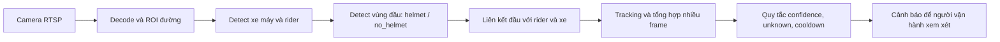

# Research Helmet Detection: Scope + Dataset + Pipeline + Risk + triển khai

Phạm vi đã chốt: người đi xe máy có mũ / không mũ. Baseline hiện tại chỉ phát hiện
vùng đầu theo hai nhãn này. Để đưa ra sự kiện vi phạm cần thêm xác nhận người đó
đang đi xe máy, liên kết đầu–người–xe và kiểm chứng qua nhiều frame.

## 1. Scope

**Đầu vào:** ảnh/video camera giao thông; bước nghiên cứu ưu tiên ban ngày,
đầu đủ rõ, người lái và người ngồi sau đều thuộc phạm vi.

**Đầu ra:** bounding box vùng đầu, `helmet` hoặc `no_helmet`, confidence.
Khi đầu quá nhỏ, bị che hoặc confidence thấp, trả về trạng thái chưa xác định ở
hệ thống triển khai. Không có detection không có nghĩa là không đội mũ.

**Ngoài phạm vi pilot:** đọc biển số, nhận dạng danh tính, đánh giá cài quai đúng,
kiểm định chất lượng mũ, tự động phạt, bảo đảm realtime và nhận diện ban đêm.

**Câu hỏi nghiên cứu:** detector nhỏ có đạt recall lớp không mũ mà không tạo
quá nhiều cảnh báo sai trên camera Việt Nam? Chất lượng thay đổi thế nào theo
kích thước đầu, mưa, đêm, che khuất và góc camera?

## 2. Dataset đã tìm và kiểm tra

| Dataset / nguồn | Nội dung xác minh | Quyết định |
|---|---|---|
| [EMHDD](https://github.com/AlanLowe007/EMHDD) | README mô tả 52,800 ảnh từ 265 video; bản public đã tải chỉ có 56 ảnh recognizer ban ngày với `no_helmet`, `helmet` | Dùng cho pilot hai lớp. Không tuyên bố đã train trên toàn corpus. Chưa thấy license rõ ràng. |
| [MHDD](https://github.com/kunalagrawal2611/Motorcycle-Helmet-Detection-Dataset--MHDD-) | Tải thành công ZIP color 655,088,895 byte qua Git LFS; SHA256 khớp pointer nguồn; CC BY 4.0. 1,000 ảnh gốc, split 800/100/100; thêm fog/rain/snow. YAML có `helmet`, `motorcycle`, không có `no_helmet`. | Có thể dùng thêm để train xe máy/helmet sau audit, hoặc gán nhãn bổ sung. Chưa đủ cho scope hai lớp. |
| [YOLO Helmet/Head/Motorcycle/Plate](https://github.com/TheSiddheshFulawade/YOLO-dataset-with-annotations-for-Helmet-No-Helmet-Motorcycles-and-Numberplates) | 1,923 ảnh; classes.txt ghi Helmet, Human head, Motorcycle, Vehicle registration plate. Kiểm tra crop thấy chân dung, mũ thể thao, mũ quân đội, búp bê; thiếu license rõ ràng. | Loại khỏi baseline vì Human head không đồng nghĩa với người đi xe máy không mũ. |
| [SHWD](https://github.com/njvisionpower/Safety-Helmet-Wearing-Dataset) | README mô tả 7,581 ảnh mũ bảo hộ và đầu người; nguồn dùng cả SCUT-HEAD | Không chọn cho giao thông xe máy vì lệch miền dữ liệu. Chỉ đọc tài liệu nguồn, chưa tải corpus. |

**Audit EMHDD thực tế:** 56 ảnh đọc được, 56 nhãn tương ứng; 56 pixel hash duy nhất;
không có cặp pHash cách nhau ≤6 bit. Tất cả box qua kiểm tra class, số trường,
độ hữu hạn, khoảng chuẩn hóa và biên ảnh. Không bỏ qua nhãn lỗi để làm train chạy.
Nhãn nguồn giữ nguyên, chưa kiểm tra exhaustiveness của annotation trên mọi ảnh.

Split seed 42: train 39 ảnh (60 no_helmet, 33 helmet), validation 8 ảnh
(20 no_helmet, 5 helmet), test 9 ảnh (18 no_helmet, 4 helmet).
Script gom ảnh trùng/gần trùng trước chia tập; trong bản này không có cặp nào
được gom. Đây vẫn là **split ảnh**, chưa phải split theo video/camera, do nguồn
không cung cấp ID. Một số cảnh cùng địa điểm có thể xuất hiện ở nhiều tập.
Các chỉ số test chỉ phản ánh pilot nhỏ, có khả năng lạc quan do tương quan cảnh.

**MHDD có vấn đề metadata:** `train/classes.txt` có thứ tự motorcycle/helmet,
khác với `data.yaml` helmet/motorcycle. Kiểm tra crop cho thấy class 0 là vùng mũ,
class 1 là xe máy. Không sử dụng loader mà chưa xác minh mapping.
Các nhóm suy đoán từ hậu tố tên file xuất hiện ở cả train/valid/test; chưa có bằng
chứng đó là ID video chính thức. Nếu dùng MHDD phải kiểm tra nguồn frame và
chia lại theo cảnh/video; augmentation của cùng ảnh phải thuộc cùng tập.

**Dataset cần bổ sung:** ảnh camera Việt Nam với quyền sử dụng rõ ràng, lớp
`helmet`, `no_helmet`, `rider`, `motorcycle`, kèm camera/video/track IDs.
Thu thập cả xe máy thật và xe đạp/xe điện để kiểm tra khả năng phân biệt phương tiện.
Gán trạng thái không xác định khi không nhìn đủ rõ; không ép nhãn nhị phân.
Gán nhãn theo hướng dẫn thống nhất về box vùng đầu và kiểm tra chéo một phần mẫu.
Số ảnh cuối cùng cần dựa trên độ phủ cảnh và learning curve, không chỉ đếm frame.

## 3. Pipeline thực hiện

1. Download archive public ở commit cố định; kiểm tra SHA256 và ZIP path trước extract.
2. Audit image–label, class mapping, tọa độ, pixel hash và pHash; lưu manifest từng ảnh.
3. Chia train/val/test trước augmentation; seed 42, test giữ riêng.
4. Fine-tune **YOLO11n pretrained COCO**, input 640, batch 4, CPU 4 thread,
   AdamW lr 0.001, freeze 10 module đầu, tối đa 30 epoch, early stopping 10.
   Augmentation nhẹ: flip ngang, rotation 5°, scale 0.2, mosaic 0.5; không flip dọc.
5. Chọn best checkpoint bằng validation fitness của Ultralytics; chạy test sau train.
6. Báo mAP50 và mAP50–95; đo TP/FP/FN, precision/recall/F1 tại conf=0.25,
   IoU match=0.5 riêng từng lớp. Threshold 0.25 là mặc định pilot, chưa hiệu chỉnh sản phẩm.
7. Kiểm thử inference trên ảnh test thật; xuất ảnh và JSON. Export ONNX opset 17,
   checker và đối chiếu tensor đầu ra với PyTorch trước NMS.

Kết quả thực tế và thời gian chạy nằm trong `model-card.md` và `artifacts/`.
Phép kiểm tra ONNX xác thực export, không chứng minh model chính xác ngoài thực tế.
Cấu hình GPU trong `configs/production-plan.yaml` là đề xuất, **chưa chạy**.

## 4. Risk và cách xử lý

| Rủi ro | Hệ quả | Cách xử lý |
|---|---|---|
| Chỉ 56 ảnh ban ngày; lớp helmet ít | Overfit; chỉ số dao động mạnh | Thu thập dữ liệu có quyền sử dụng; đánh giá camera độc lập; nhiều seed khi corpus đủ lớn |
| Chung cảnh/video giữa các tập | mAP cao giả tạo | Tách theo video/camera/thời gian; giữ toàn bộ bản augmentation cùng nguồn |
| Xe đạp/xe điện/người đứng gần xe xuất hiện trong nhãn | Cảnh báo sai cho người không đi xe máy | Thêm nhãn phương tiện/rider và liên kết không gian + tracking |
| Đầu nhỏ, che khuất, tóc/mũ thời trang | Nhầm hoặc bỏ sót không mũ | Tăng resolution/crop ROI; nhóm test theo kích thước đầu; có trạng thái unknown |
| Mưa/đêm, camera Việt Nam khác nguồn Trung Quốc | Domain shift | Test local theo điều kiện; dữ liệu mưa nhân tạo không thay cho mưa thật |
| Annotation thiếu hoặc không nhất quán | Học nhãn sai; metric không đáng tin | Audit lại, adjudication và quy tắc box rõ ràng |
| License EMHDD chưa rõ; AGPL của Ultralytics | Hạn chế phân phối/triển khai | Xin phép tác giả dữ liệu; chọn giấy phép phần mềm phù hợp trước phát hành |
| Video chứa khuôn mặt/biển số | Tăng rủi ro riêng tư | Xử lý tại edge; hạn chế lưu, che thông tin không cần thiết, phân quyền |
| Tài nguyên chỉ CPU | Không đủ throughput nhiều camera | Đo end-to-end trên thiết bị thật; chọn GPU/edge accelerator sau benchmark |

## 5. Hướng triển khai

**Giai đoạn 1 – nghiên cứu:** mở rộng dataset đúng miền, video-disjoint split,
YOLO11n baseline so với model lớn hơn trên cùng split; kiểm tra false positives
ở mũ thời trang, người đi bộ, xe đạp và đám đông. Báo chỉ số theo điều kiện,
không chỉ số aggregate.

**Giai đoạn 2 – chạy thử camera:** inference ONNX Runtime CPU hoặc TensorRT GPU,
tracker như ByteTrack, liên kết rider–head–motorcycle, yêu cầu nhiều frame nhất
quán trước cảnh báo; không lặp cảnh báo cùng track. Thử threshold và số frame
trên validation camera, sau đó khóa cấu hình trước test. ONNX hiện export tĩnh
640×640; muốn resolution khác phải export lại và kiểm tra parity.

**Giai đoạn 3 – vận hành có giám sát:** API nội bộ nhận image/frame hoặc worker
đọc RTSP, hàng đợi giới hạn để tránh trễ tăng dần, metrics FPS/latency/drop frame,
log version model/config, lịch lấy mẫu đánh giá drift và rollback checkpoint.
Chưa triển khai RTSP, tracker, API hay TensorRT trong pilot này.

**Mục tiêu nghiệm thu đề xuất, chưa đạt/chưa đo trên camera thật:** no_helmet
precision ≥95%, recall ≥90%, ≤1 cảnh báo sai/camera/giờ, latency end-to-end p95
≤500 ms trên phần cứng mục tiêu. Cần chốt theo chi phí cảnh báo sai và bỏ sót.
Báo cả recall ở mức track; dữ liệu test 9 ảnh không đo được cảnh báo/camera/giờ.
Không dùng pilot để tự động xử phạt.
